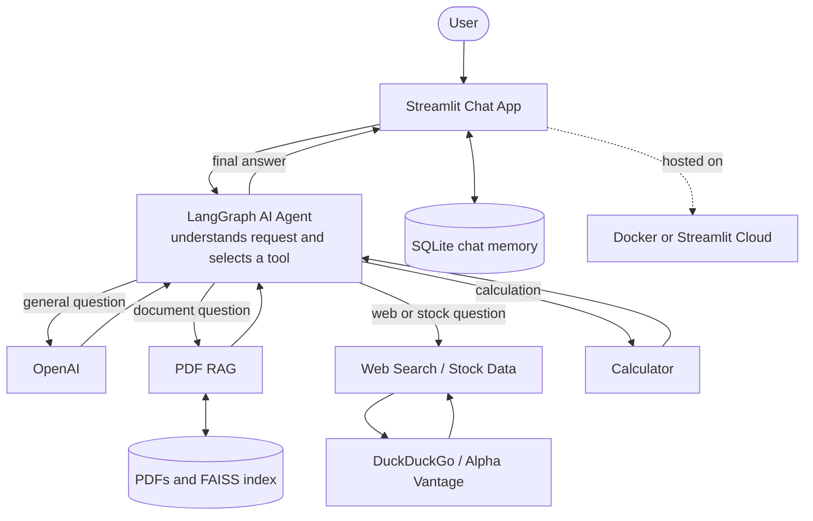

# Multi-Utility Agentic Chatbot

A Streamlit chatbot with LangGraph, PDF question answering (RAG), web search,
stock quotes, and a calculator.

## UI preview

<p align="center">
  
</p>

## System architecture



**In short:** the user sends a message in the chat; the AI agent answers
directly or uses the matching capability (PDF retrieval, web/stock lookup, or
calculation); then the app returns the answer and saves the conversation.
Uploaded PDFs are indexed for later questions in that chat.

## 🌟 Key Technical Highlights

[](https://github.com/mr360cool/Multi-Utility-Chatbot#-key-technical-highlights)

### 1. Agentic Tool Selection

[](https://github.com/mr360cool/Multi-Utility-Chatbot#1-agentic-tool-selection)

- Uses a LangGraph message-state workflow with an OpenAI `gpt-4o-mini` model
  bound to the available tools.
- The model decides whether to answer directly or request document retrieval,
  web search, a stock quote, or a calculation.

### 2. PDF Ingestion and Retrieval-Augmented Generation

[](https://github.com/mr360cool/Multi-Utility-Chatbot#2-pdf-ingestion-and-retrieval-augmented-generation)

- Parses uploaded PDFs into page-aware documents, then splits them into
  1,000-character chunks with 200-character overlap.
- Creates embeddings with OpenAI `text-embedding-3-small` and stores vectors
  in a FAISS index dedicated to the conversation.
- Retrieves up to four relevant chunks for document questions.

### 3. Evidence-Grounded Document Answers

[](https://github.com/mr360cool/Multi-Utility-Chatbot#3-evidence-grounded-document-answers)

- Instructs the model to cite document claims using `[Filename, Page X]`.
- Requires the model to say when uploaded documents do not contain enough
  evidence, rather than inventing an answer.

### 4. Multi-Utility Tools

[](https://github.com/mr360cool/Multi-Utility-Chatbot#4-multi-utility-tools)

- **Web search:** DuckDuckGo search for public and current information.
- **Stock quotes:** Alpha Vantage ticker lookup with bounded network retries
  and rate-limit/error handling.
- **Calculator:** Addition, subtraction, multiplication, and division, with a
  guard against division by zero.

### 5. Per-Conversation State and Document Isolation

[](https://github.com/mr360cool/Multi-Utility-Chatbot#5-per-conversation-state-and-document-isolation)

- Stores LangGraph conversation checkpoints in SQLite using a conversation
  thread ID.
- Maintains a separate FAISS index and uploaded-document metadata for each
  thread, so retrieval uses that conversation's documents.
- Validates thread IDs before using them to construct vectorstore paths.

### 6. Streaming Chat Interface

[](https://github.com/mr360cool/Multi-Utility-Chatbot#6-streaming-chat-interface)

- Streams assistant responses in the Streamlit UI and shows status while a
  tool is running.
- Provides quick-action prompts, PDF upload and removal, conversation search,
  and thread switching in the sidebar.

## Requirements

- Python 3.11 or later
- An OpenAI API key
- Docker Desktop (for the containerized version)

## ⚡ Quickstart

[](https://github.com/mr360cool/Multi-Utility-Chatbot#-quickstart)

### 1. Clone & Set Up Environment

[](https://github.com/mr360cool/Multi-Utility-Chatbot#1-clone--set-up-environment)

```bash
git clone https://github.com/mr360cool/Multi-Utility-Chatbot.git
cd Multi-Utility-Chatbot

python -m venv myenv
# Windows:
myenv\Scripts\activate
# Linux/macOS:
source myenv/bin/activate

pip install -r requirements.txt
```

### 2. Configure Environment Variables

[](https://github.com/mr360cool/Multi-Utility-Chatbot#2-configure-environment-variables)

Copy the example environment file and add your API keys:

```bash
# Windows PowerShell:
Copy-Item .env.example .env
# Linux/macOS:
cp .env.example .env
```

Edit `.env`:

```dotenv
OPENAI_API_KEY=your-openai-api-key

# Optional: enables stock quote lookups
ALPHA_VANTAGE_API_KEY=your-alpha-vantage-api-key

# Optional: LangSmith tracing
LANGSMITH_TRACING=true
LANGSMITH_ENDPOINT=https://api.smith.langchain.com
LANGSMITH_API_KEY=your-langsmith-api-key
LANGSMITH_PROJECT=multi-utility-agentic-rag
```

`OPENAI_API_KEY` is required for chat and PDF embeddings.

### 3. Start the app

[](https://github.com/mr360cool/Multi-Utility-Chatbot#3-start-the-app)


```bash
streamlit run final_frontend.py
```

## 🛠️ Tech Stack

[](https://github.com/mr360cool/Multi-Utility-Chatbot#-tech-stack)

- **Frameworks:** Python, Streamlit, LangChain, LangGraph
- **LLM & Embeddings:** OpenAI (`gpt-4o-mini`, `text-embedding-3-small`)
- **Document RAG:** PyPDF, FAISS, LangChain text splitters
- **Tools:** DuckDuckGo web search, Alpha Vantage stock quotes, arithmetic calculator
- **State & Storage:** SQLite checkpoints, per-conversation FAISS indexes
- **Observability:** Optional LangSmith tracing and response feedback
- **Deployment:** Docker Compose and Streamlit Community Cloud
