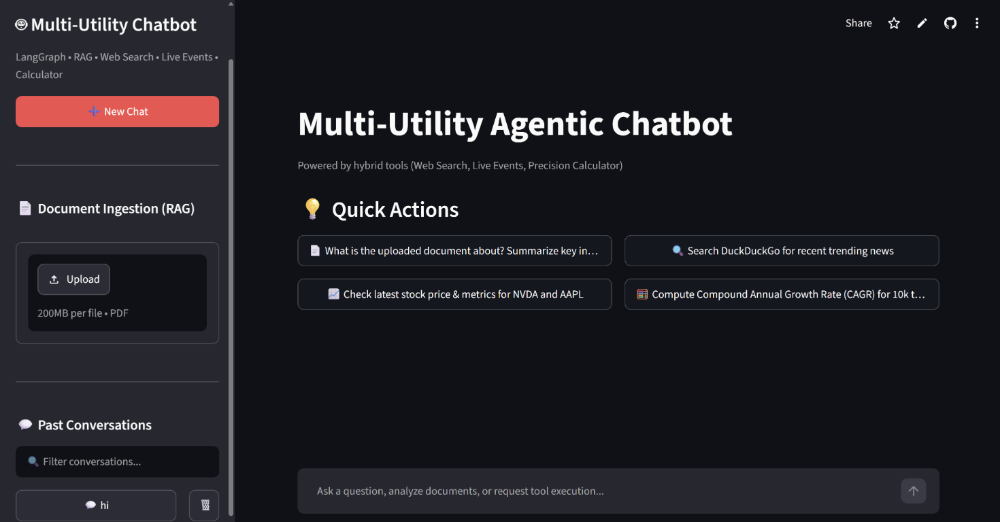

# Multi-Utility Agentic Chatbot

A Streamlit chatbot with LangGraph, PDF question answering (RAG), web search,
stock quotes, and a calculator.

## UI preview

<p align="center">
  
</p>

## System architecture


**In short:** the user sends a message in the chat; the AI agent answers
directly or uses the matching capability (PDF retrieval, web/stock lookup, or
calculation); then the app returns the answer and saves the conversation.
Uploaded PDFs are indexed for later questions in that chat.

## Technical highlights

- **Agent orchestration:** LangGraph maintains a message-based state graph.
  `tools_condition` routes model responses either to the tool node or to the
  end of the turn; tool results flow back through the chat node.
- **Conversation memory:** `SqliteSaver` checkpoints graph state in
  `chatbot.db`, keyed by the conversation's thread ID, so prior messages can be
  restored for later turns.
- **Document Q&A (RAG):** PDF uploads are parsed into page-aware documents,
  split into 1,000-character chunks with 200-character overlap, and indexed
  with FAISS using OpenAI `text-embedding-3-small` embeddings. The retriever
  returns up to four similar chunks. Answers are instructed to cite filenames
  and page numbers and to say when evidence is insufficient.
- **Thread-scoped documents:** Each conversation has its own vector index and
  document metadata. SHA-256 file hashes support duplicate detection, while
  thread IDs are validated before being used in storage paths.
- **Specialized tools:** DuckDuckGo provides web search; Alpha Vantage provides
  ticker quotes (with bounded retries and rate-limit/error handling); and the
  calculator performs addition, subtraction, multiplication, and division,
  including a division-by-zero guard.
- **Streaming UI:** Streamlit renders assistant text as it arrives and shows a
  status when a tool runs. The sidebar supports PDF upload/removal, chat
  history, and thread switching.
- **Configuration and observability:** API keys are read from environment
  variables; on Community Cloud, Streamlit Secrets are copied into the
  environment before backend initialization. LangSmith tracing and response
  feedback are optional.
- **Deployment and persistence:** Docker Compose stores SQLite checkpoints and
  FAISS indexes in named volumes. Streamlit Community Cloud's local filesystem
  is temporary, so chat and uploaded-document data are not guaranteed to
  persist across restarts.

## Requirements

- Python 3.11 or later
- An OpenAI API key
- Docker Desktop (for the containerized version)

## ⚡ Quickstart

[](https://github.com/mr360cool/Multi-Utility-Chatbot#-quickstart)

### 1. Clone & Set Up Environment

[](https://github.com/mr360cool/Multi-Utility-Chatbot#1-clone--set-up-environment)

```bash
git clone https://github.com/mr360cool/Multi-Utility-Chatbot.git
cd Multi-Utility-Chatbot

python -m venv myenv
# Windows:
myenv\Scripts\activate
# Linux/macOS:
source myenv/bin/activate

pip install -r requirements.txt
```

### 2. Configure Environment Variables

[](https://github.com/mr360cool/Multi-Utility-Chatbot#2-configure-environment-variables)

Copy the example environment file and add your API keys:

```bash
# Windows PowerShell:
Copy-Item .env.example .env
# Linux/macOS:
cp .env.example .env
```

Edit `.env`:

```dotenv
OPENAI_API_KEY=your-openai-api-key

# Optional: enables stock quote lookups
ALPHA_VANTAGE_API_KEY=your-alpha-vantage-api-key

# Optional: LangSmith tracing
LANGSMITH_TRACING=true
LANGSMITH_ENDPOINT=https://api.smith.langchain.com
LANGSMITH_API_KEY=your-langsmith-api-key
LANGSMITH_PROJECT=multi-utility-agentic-rag
```

`OPENAI_API_KEY` is required for chat and PDF embeddings.

### 3. Start the app

[](https://github.com/mr360cool/Multi-Utility-Chatbot#3-start-the-app)


```bash
streamlit run final_frontend.py
```

## 🛠️ Tech Stack

[](https://github.com/mr360cool/Multi-Utility-Chatbot#-tech-stack)

- **Frameworks:** Python, Streamlit, LangChain, LangGraph
- **LLM & Embeddings:** OpenAI (`gpt-4o-mini`, `text-embedding-3-small`)
- **Document RAG:** PyPDF, FAISS, LangChain text splitters
- **Tools:** DuckDuckGo web search, Alpha Vantage stock quotes, arithmetic calculator
- **State & Storage:** SQLite checkpoints, per-conversation FAISS indexes
- **Observability:** Optional LangSmith tracing and response feedback
- **Deployment:** Docker Compose and Streamlit Community Cloud
