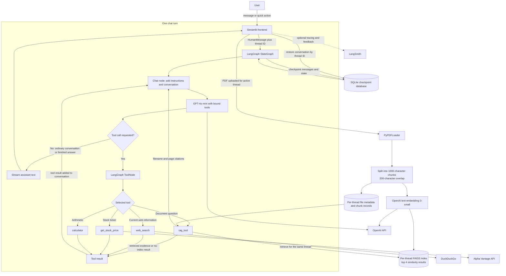

# Multi-Utility Agentic Chatbot

A Streamlit chatbot with LangGraph, PDF question answering (RAG), web search,
stock quotes, and a calculator.

## System architecture



The model chooses whether a message needs a tool; the app does not route user
prompts with keyword rules. When it requests a tool, LangGraph runs that tool,
adds its result to the same conversation, and calls the chat node again. This
tool cycle can repeat until the model returns a final answer, which the
frontend streams to the user. A thread ID ties messages, checkpoints, uploaded
documents, and retrieved context to a conversation.

## Technical highlights

- **Agent orchestration:** LangGraph maintains a message-based state graph.
  `tools_condition` routes model responses either to the tool node or to the
  end of the turn; tool results flow back through the chat node.
- **Conversation memory:** `SqliteSaver` checkpoints graph state in
  `chatbot.db`, keyed by the conversation's thread ID, so prior messages can be
  restored for later turns.
- **Document Q&A (RAG):** PDF uploads are parsed into page-aware documents,
  split into 1,000-character chunks with 200-character overlap, and indexed
  with FAISS using OpenAI `text-embedding-3-small` embeddings. The retriever
  returns up to four similar chunks. Answers are instructed to cite filenames
  and page numbers and to say when evidence is insufficient.
- **Thread-scoped documents:** Each conversation has its own vector index and
  document metadata. SHA-256 file hashes support duplicate detection, while
  thread IDs are validated before being used in storage paths.
- **Specialized tools:** DuckDuckGo provides web search; Alpha Vantage provides
  ticker quotes (with bounded retries and rate-limit/error handling); and the
  calculator performs addition, subtraction, multiplication, and division,
  including a division-by-zero guard.
- **Streaming UI:** Streamlit renders assistant text as it arrives and shows a
  status when a tool runs. The sidebar supports PDF upload/removal, chat
  history, and thread switching.
- **Configuration and observability:** API keys are read from environment
  variables; on Community Cloud, Streamlit Secrets are copied into the
  environment before backend initialization. LangSmith tracing and response
  feedback are optional.
- **Deployment and persistence:** Docker Compose stores SQLite checkpoints and
  FAISS indexes in named volumes. Streamlit Community Cloud's local filesystem
  is temporary, so chat and uploaded-document data are not guaranteed to
  persist across restarts.

## Requirements

- Python 3.11 or later
- An OpenAI API key
- Docker Desktop (for the containerized version)

## Run locally with Python

1. Create and activate a virtual environment.
2. Install dependencies:

   ```powershell
   python -m pip install -r requirements.txt
   ```

3. Copy `.env.example` to `.env` and enter your API keys. `OPENAI_API_KEY` is
   required for chat and document embeddings. `ALPHA_VANTAGE_API_KEY` enables
   stock quotes. LangSmith settings are optional.
4. Start the app:

   ```powershell
   streamlit run final_frontend.py
   ```

## Run with Docker Desktop

1. Copy `.env.example` to `.env` and set the keys you want to use.
2. In the project directory, build and start the app:

   ```powershell
   docker compose up --build
   ```

3. Open <http://localhost:8501>.
4. Stop the app with `Ctrl+C`; run `docker compose down` to remove the
   container. Conversation data and vector indexes are stored in Docker named
   volumes and remain available when the container is recreated.

## Deploy on Streamlit Community Cloud

1. Push this repository to GitHub without committing `.env` or API keys.
2. In Streamlit Community Cloud, create an app from the repository, select
   `final_frontend.py` as the entry point, and deploy.
3. In the app's **Settings → Secrets**, add the keys needed by the app using
   TOML format:

   ```toml
   OPENAI_API_KEY = "your-openai-api-key"
   ALPHA_VANTAGE_API_KEY = "your-alpha-vantage-api-key"
   LANGSMITH_TRACING = "true"
   LANGSMITH_ENDPOINT = "https://api.smith.langchain.com"
   LANGSMITH_API_KEY = "your-langsmith-api-key"
   LANGSMITH_PROJECT = "multi-utility-agentic-rag"
   ```

   Only `OPENAI_API_KEY` is required. Omit optional keys if you do not use those
   services. Streamlit Secrets are loaded into the environment before the
   backend and LangSmith client are initialized.
4. Wait for the app to finish building. Streamlit Community Cloud will provide
   its shareable `*.streamlit.app` URL.

Community Cloud's local filesystem is not durable storage. Conversation and
uploaded-document data may be lost when the app restarts or is redeployed.
Docker Compose, by contrast, keeps this data in local Docker named volumes.
